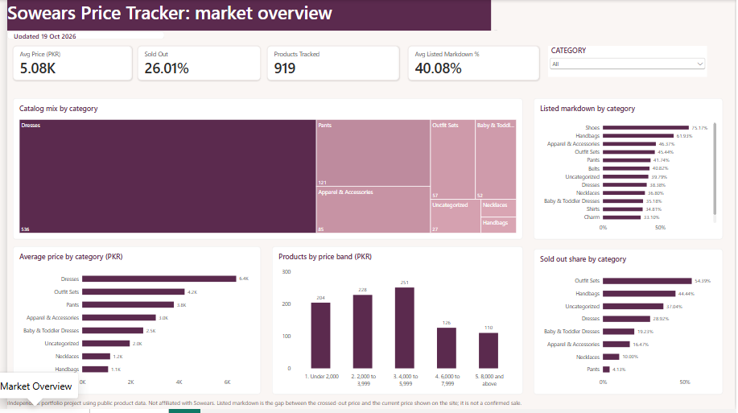
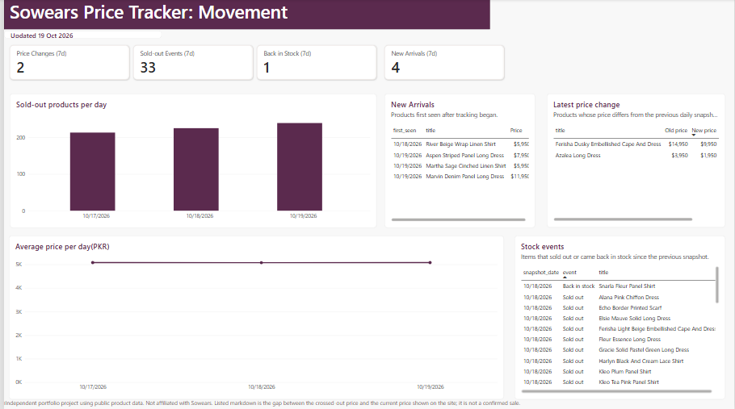
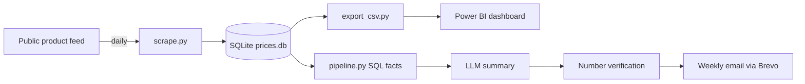

# Sowears Price Tracker: automated price monitoring with AI-written reports


An end-to-end data pipeline that collects product prices and stock status from a public online store every day, stores dated snapshots, detects price and stock changes, and emails a weekly summary written by an LLM and checked against the underlying SQL results. A two-page Power BI dashboard sits on top of the same data.

## Dashboard

**Market overview:** catalog mix, price bands, sold-out share and listed markdown by category.



**Movement:** price changes, stock events and new arrivals, updated daily.



## Why this project

Online stores change prices and stock constantly, but most data sets are one-off snapshots. This project builds its own history from scratch, so it can answer what changed and when. It runs entirely on free tools, with no machine of mine switched on.

## How it works



1. **Collect:** GitHub Actions runs `src/scrape.py` every day. It reads the store's public product feed, with pauses between requests, and saves one dated row per product (cheapest variant price, listed "was" price, stock status).
2. **Store:** SQLite holds a products table and a price-snapshots table. The workflow commits the updated database back to the repo.
3. **Export:** `src/export_csv.py` writes CSV files for Power BI: price history, price changes, stock changes, new arrivals and a daily summary.
4. **Analyse:** `src/pipeline.py` compares the latest snapshot with one from about a week earlier using SQL: price drops and rises, new and removed products, changes by category.
5. **Explain:** the aggregated results (never raw rows) go to an LLM, which writes a short summary and recommendations.
6. **Verify:** every number in the summary is checked against the SQL results, and the email is flagged if anything doesn't match.
7. **Deliver:** a second workflow emails the report weekly through Brevo.

## Tech stack

Python (pandas, requests), SQL (SQLite), GitHub Actions, Brevo API, Groq LLM API, Power BI.

## Findings (as of 19 Oct 2026, three daily snapshots)

**Catalog and pricing**
- 919 products are tracked (921 on the first day), with an average price of PKR 5,080. Dresses are 536 of them (58%) and have the highest average price, about PKR 6,400.
- Just over half the catalog (479 of 919 products, 52%) is priced between PKR 2,000 and 5,999. 110 products (12%) cost PKR 8,000 or more.

**Stock moves much more than price**
- The sold-out share rose from 23.1% to 26.0% of the catalog between 17 and 19 Oct. In that time 33 products sold out and 1 came back in stock.
- Among categories with at least 50 products, outfit sets have the highest sold-out share (54%), against 29% for dresses and 4% for pants.

**Price changes are rare**
- Only 2 price changes appeared across the three snapshots, about 0.2% of the catalog. Both were price cuts: Azalea Long Dress (PKR 3,950 to 1,950, down 51%) and Ferisha Dusky Embellished Cape And Dress (PKR 14,950 to 9,950, down 33%).
- I'm watching whether this changes around the 11.11 sale period. Tracking continues daily.

**New arrivals**
- 4 new products appeared: two dresses and two shirts, priced between PKR 5,950 and 11,950.

**A note on "was" prices**
- The store shows a crossed-out price on most items, with an average gap of about 40% between that price and the current one. Because it appears on roughly two thirds of variants (3,166 of 4,810 on day one), I don't treat it as a sale signal and track actual price changes instead.

## Design decisions

- **Dated snapshots, not overwrites.** Each day adds rows, so history builds up and changes can be computed.
- **The LLM only explains, it never calculates.** SQL produces the numbers, the model writes the words, and a checker flags anything that doesn't match.
- **Safety check before saving.** The scraper refuses to save a snapshot with unexpectedly few products, so a broken fetch can't corrupt the history.
- **Re-runs are safe.** Running the scraper twice in one day replaces that day's rows instead of duplicating them.

## Run it yourself

```bash
git clone https://github.com/nimra-maker/price-intelligence-pipeline.git
cd price-intelligence-pipeline
python -m venv venv
venv\Scripts\activate
pip install -r requirements.txt
python src/scrape.py
python src/pipeline.py
```

For the report and email, create a `.env` file with `GROQ_API_KEY`, `GROQ_MODEL`, `BREVO_API_KEY`, `EMAIL_SENDER` and `EMAIL_RECIPIENT`. For automation, add the same names as GitHub Actions secrets.

## Limitations

- History began on 17 Oct 2026, so these are early observations, not trends.
- "Sold out" is the store's availability flag. It can reflect real sales or stock management, so it isn't a direct measure of demand.
- Prices are for the cheapest variant of each product, in PKR, for a single store.
- Listed markdown is the gap between the crossed-out price and the current price shown on the site. It isn't a confirmed sale.

## Data and ethics

This is an independent learning project, not affiliated with Sowears. It reads publicly available product data at low volume (a handful of requests a day, with pauses between them) and checks the site's robots.txt rules. No personal data is collected.

## What I'd add next

Alerts for large price drops, more stores, and a hosted version of the dashboard.