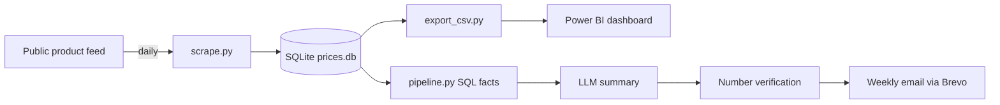

# Sowears Price Tracker: automated price monitoring with AI-written reports

An end-to-end data pipeline that collects product prices from a public online store every day, stores dated snapshots, detects price changes, and emails a weekly summary written by an LLM and checked against the underlying SQL results. A Power BI dashboard sits on top of the same data.


## Why this project

Online stores change prices constantly, but most data sets are one-off snapshots. This project builds its own price history from scratch, so it can answer what changed and when. It runs fully on free tools, with no machine of mine switched on.

## How it works



1. **Collect:** GitHub Actions runs `src/scrape.py` every day. It reads the store's public product feed, one polite request per page, and saves one dated row per product.
2. **Store:** SQLite holds a products table and a price-snapshots table, committed back to the repo by the workflow.
3. **Analyse:** `src/pipeline.py` compares the latest snapshot with one from about a week earlier using SQL (price drops, price rises, new and removed products, changes by category).
4. **Explain:** the aggregated results (never raw rows) go to an LLM, which writes a short summary and recommendations.
5. **Verify:** every number in the summary is checked against the SQL results. If something doesn't match, the email is flagged.
6. **Deliver:** the report is emailed through Brevo. A second workflow does this weekly.
7. **Visualise:** `src/export_csv.py` writes CSV files that feed the Power BI dashboard.

## Tech stack

Python (pandas, requests), SQL (SQLite), GitHub Actions, Brevo API, Groq LLM API, Power BI.

## Design decisions

- **Dated snapshots, not overwrites.** Each day adds rows, so history builds up and price changes can be computed.
- **A "was" price isn't a sale signal.** In the first snapshot, 3,166 of 4,810 variants carried a crossed-out price. A discount badge was shown almost everywhere, so I track real price changes between dates instead.
- **The LLM only explains, it never calculates.** SQL produces the numbers, the model writes the words, and a checker flags anything that doesn't match.
- **Safety check before saving.** The scraper refuses to save a snapshot with unexpectedly few products, so a broken fetch can't corrupt the history.
- **Re-runs are safe.** Running the scraper twice in one day replaces that day's rows instead of duplicating them.

## Findings

First snapshot (17 Oct 2026): 
- 921 products tracked, with an average price of PKR 5,080.
- Dresses are the largest category (537 products) with an average price of PKR 6,371. Pants (121 products) average PKR 3,794.
- About 23% of products were sold out on that day.
- A crossed-out "was" price appears on roughly two thirds of variants (3,166 of 4,810), so it can't be used as a sale signal. Real price changes between dates are tracked instead.

Price changes: tracking started on 17 Oct 2026. Results will be added once prices start moving, including during the 11.11 sale period.

## Run it yourself

```bash
git clone https://github.com/nimra-maker/price-intelligence-pipeline.git
cd price-intelligence-pipeline
python -m venv venv
venv\Scripts\activate
pip install -r requirements.txt
python src/scrape.py
python src/pipeline.py
```

For the report and email, create a `.env` file with `GROQ_API_KEY`, `GROQ_MODEL`, `BREVO_API_KEY`, `EMAIL_SENDER` and `EMAIL_RECIPIENT`. For automation, add the same names as GitHub Actions secrets.

## Limitations

- History only starts on 17 Oct 2026, so trends are short-term.
- Prices are for the cheapest variant of each product, in PKR.
- It tracks one store. The scraper reads a public product feed, so it only works for stores that expose one.

## Data and ethics

This is an independent learning project, not affiliated with Sowears. It reads publicly available product data at low volume (about five requests a day, with pauses between them) and checks the site's robots.txt rules. No personal data is collected.

## What I'd add next

Alerts for large price drops, more stores, and a hosted version of the dashboard.